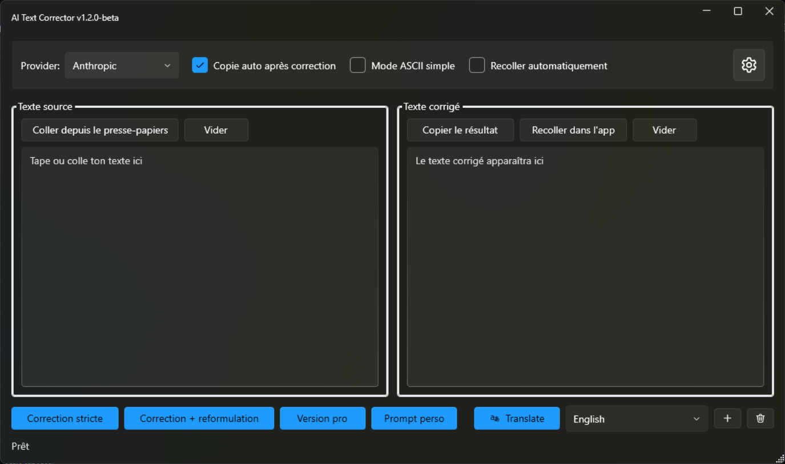
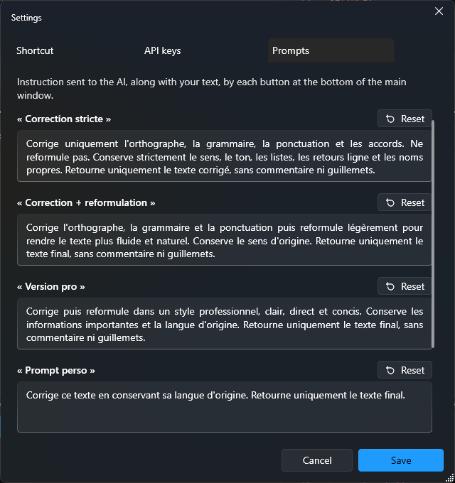

<p align="center">
  
</p>

<h1 align="center">AI Text Corrector</h1>

<p align="center">
  Fix, rewrite or translate the text you are writing, in any Windows application,<br>
  with one keyboard shortcut and one click.
</p>

---

AI Text Corrector is a small Windows tray application. Select text in any program (a mail
client, a browser, a chat, an editor), press the global shortcut, and the window opens with
your selection already loaded. One click sends it to the AI provider of your choice
(OpenAI, Anthropic Claude, GLM or Groq), and the corrected text can be pasted straight back
where it came from.

```text
select text  ->  press the shortcut  ->  click a correction mode  ->  paste back
```



## Contents

- [Features](#features)
- [Requirements](#requirements)
- [Installation](#installation)
- [Updating](#updating)
- [Uninstalling](#uninstalling)
- [Getting started](#getting-started)
- [Daily use](#daily-use)
- [Settings](#settings)
- [AI providers and models](#ai-providers-and-models)
- [Configuration file](#configuration-file)
- [Where your data goes](#where-your-data-goes)
- [Troubleshooting](#troubleshooting)
- [Building from source](#building-from-source)
- [Publishing](#publishing)
- [Project structure](#project-structure)
- [License](#license)

## Features

- **Works in any application.** A global shortcut captures the selected text (the app sends
  `Ctrl+C` for you) and opens the window, which stays on top.
- **Four correction modes**, each driven by an editable prompt: strict correction, correction
  with a light rewrite, professional style, and a custom prompt.
- **Translation** of the result into a language picked from your own list. Add languages by
  typing the first letters of their name, with suggestions from about 280 languages.
- **Four AI providers**: OpenAI, Anthropic (Claude), GLM (Z.ai) and Groq. Switch from a list
  showing only the providers you have a key for.
- **Paste back**: the result is copied to the clipboard and can be pasted into the original
  application, automatically or with one click.
- **Plain text output**: no formatting is ever pasted. An optional ASCII mode strips accents and
  non-ASCII characters.
- **Character-level undo** in the source box: `Ctrl+Z` goes back one keystroke at a time and also
  undoes text loaded by the app.
- **Lives in the notification area** and can start with Windows.
- **Single self-installing executable**: run it to install, run a newer one to update. No
  administrator rights needed.

## Requirements

- Windows 10 or Windows 11, 64-bit.
- The [.NET 8 Desktop Runtime](https://dotnet.microsoft.com/download/dotnet/8.0) (x64). If it is
  missing, Windows shows a dialog with a download link the first time you start the app.
- An API key for at least one supported provider (see [AI providers and models](#ai-providers-and-models)).

## Installation

1. Download **`AiTextCorrector.exe`** from the
   [latest release](https://github.com/JMMaupin/AiTextCorrector/releases/latest).
2. Run it. The executable is not code-signed, so Windows SmartScreen may show
   *"Windows protected your PC"*: click **More info**, then **Run anyway**.
3. The installation window opens:
   - **Install** copies the application for your Windows account only, with no administrator
     rights, to `%LOCALAPPDATA%\Programs\AiTextCorrector`. It adds an **AI Text Corrector**
     shortcut to the Start menu and an entry in *Settings > Apps > Installed apps*. Leave
     **Start with Windows** checked to have the shortcut available as soon as you log in.
   - **Run without installing** starts this copy as is; nothing is written to your computer
     apart from your settings.
4. Once installed, the app starts and a notification reminds you of the shortcut.

## Updating

Download the newer `AiTextCorrector.exe` and run it. The app detects the installed version and:

| Downloaded executable | What happens |
| --- | --- |
| Newer than the installed version | The running instance is closed, the installed executable is replaced, and the new version starts. A notification confirms the update. |
| Same version, different build | Treated as an update. |
| Same build, or older | The installed version is started; it is never downgraded. |

Your settings, prompts, languages and API keys are kept.

## Uninstalling

Open *Settings > Apps > Installed apps*, find **AI Text Corrector** and choose **Uninstall**.
You can also run:

```bat
"%LOCALAPPDATA%\Programs\AiTextCorrector\AiTextCorrector.exe" --uninstall
```

The app asks for confirmation, then whether to **also delete your settings and API keys**. The
default answer is **No**: choose it if you may reinstall later, since deleting the API keys
cannot be undone. It then closes any running instance and removes its files, the Start menu
shortcut, the startup entry and the *Installed apps* entry.

## Getting started

1. Click the **gear** button at the top right of the window.
2. Open the **API keys** tab, paste the key of at least one provider, and click **Save**.
3. Pick the provider in the **Provider** list.
4. Optional: in the **Shortcut** tab, choose another global shortcut. The default is
   **`Ctrl+Shift+Space`**.

You are ready: select some text anywhere, press the shortcut, and click a correction button.

## Daily use

### Typical flow

1. Select text in any application.
2. Press the global shortcut. The window opens with the selection in the **source** box (left).
   If nothing is selected, the app uses text you copied in the last 5 seconds, if any.
3. Click a correction mode. The result appears in the **result** box (right) and, by default,
   is copied to the clipboard.
4. Click **Recoller dans l'app** to paste the result back into the original application, or
   enable **Recoller automatiquement** to do it without the extra click.

You can also type or paste text directly into the source box.

### The main window

The main window labels are currently in French. Here is what each control does:

| Label | Action |
| --- | --- |
| **Provider** | AI provider used for the next correction or translation. |
| **Copie auto après correction** | Copy each result to the clipboard (on by default). |
| **Mode ASCII simple** | Remove accents and every non-ASCII character from the result. |
| **Recoller automatiquement** | Paste each result back into the original application automatically. |
| Gear button | Open the [settings](#settings). |
| **Coller depuis le presse-papiers** | Load the clipboard into the source box. |
| **Vider** | Clear the box above which it sits. |
| **Copier le résultat** | Copy the result to the clipboard. |
| **Recoller dans l'app** | Paste the result into the application you came from. |
| **Correction stricte** | Fix spelling, grammar and punctuation only, without rephrasing. |
| **Correction + reformulation** | Fix, then lightly rephrase for a smoother text. |
| **Version pro** | Fix, then rewrite in a professional, concise style. |
| **Prompt perso** | Run your own custom prompt. |
| **Translate** | Translate the result into the language selected next to it. |

The three check boxes apply to the current session and are reset to their defaults at each start.

All correction prompts ask the AI to keep the text in its original language, so a French text
stays French. Every prompt can be changed in [Settings > Prompts](#prompts).

### Translation

- Choose the target language in the list next to **Translate**, then click **Translate**.
  The text in the result box is translated, including any manual edits you made. If the
  result box is empty, the source text is translated directly.
- The translation replaces the result, and the auto copy and paste back options apply as for
  a correction.
- **+** turns the list into a search field. Type the first letters of a language name, then
  press `Enter` or click a suggestion. The search understands three names for each language:
  English (`ger` finds German), native (`deu` finds German through *Deutsch*) and the language
  of your Windows regional settings (`all` finds German through *allemand* on a French system).
  A name that is not in the catalogue, such as *Brazilian Portuguese*, is accepted as typed.
- The **trash** button removes the selected language. The last language cannot be removed.
- The list starts with English and Spanish. It and the last language used are remembered.

### Undo in the source box

- `Ctrl+Z` undoes one change at a time: one typed character, one deletion, one paste. Text
  loaded by the shortcut and the **Vider** button can be undone too.
- `Ctrl+Y` or `Ctrl+Shift+Z` redoes.

### Notification area and startup

- Closing (✕) or minimizing the window hides it in the notification area; the shortcut keeps
  working.
- Double-click the tray icon to show the window. Its menu offers **Ouvrir** (open),
  **Run with Windows** (start at logon) and **Quitter** (quit the application).
- Starting the application a second time shows the window of the instance already running.

## Settings

The gear button opens the settings window. Its three tabs are saved together with **Save**;
**Cancel** or `Esc` discards every change. If a tab contains an invalid value, **Save** brings
that tab to the front and explains the problem; nothing is written until it is fixed.

### Shortcut

Click the field, then press the combination you want: at least one modifier (`Ctrl`, `Shift`,
`Alt` or `Win`) plus a key. The field turns green if the combination is free, or red if another
application or Windows already uses it.

### API keys

One field per provider. Leave a field empty to keep the saved key, type a value to replace it,
or click **Clear** to delete it when you save (**Restore** cancels the deletion). Saved keys are
never displayed. If an environment variable overrides a key, the tab says so.

### Prompts



The instruction sent to the AI by each button at the bottom of the main window: the four
correction modes and **Translate**. **Reset** restores the default text of one prompt. In the
translation prompt, `{language}` is replaced by the selected target language; if you remove it,
the target language is appended automatically.

## AI providers and models

| Provider | Default model | Model field in the configuration | Environment variable for the key |
| --- | --- | --- | --- |
| OpenAI | `gpt-4.1-mini` | `Model` | `OPENAI_API_KEY` |
| Anthropic (Claude) | `claude-sonnet-4-6` | `AnthropicModel` | `AITEXTCORRECTOR_ANTHROPIC_API_KEY` |
| GLM (Z.ai) | `glm-4.6` | `GlmModel` | `AITEXTCORRECTOR_GLM_API_KEY` |
| Groq | `openai/gpt-oss-120b` | `GroqModel` | `AITEXTCORRECTOR_GROQ_API_KEY` |

- The **Provider** list only shows providers that have a key.
- GLM and Groq are called through their OpenAI-compatible endpoints
  (`https://api.z.ai/api/paas/v4` and `https://api.groq.com/openai/v1`).
- To use another model, change the matching field in the [configuration file](#configuration-file).
  Groq models retired by Groq are replaced automatically at startup by their official successor.
- Anthropic answers are limited to 1,200 output tokens, roughly two pages of text.

## Configuration file

Settings are stored in `%APPDATA%\AiTextCorrector\appsettings.json`. The file is created at the
first start and rewritten when you change a setting in the app, so **edit it only while the
application is closed** (use *Quitter* in the tray menu).

```json
{
  "Provider": "Groq",
  "Model": "gpt-4.1-mini",
  "AnthropicModel": "claude-sonnet-4-6",
  "GlmModel": "glm-4.6",
  "GroqModel": "openai/gpt-oss-120b",
  "TranslationLanguages": [ "English", "Spanish" ],
  "TranslationLanguage": "English",
  "Hotkey": { "Ctrl": true, "Shift": true, "Alt": false, "Win": false, "Key": "Space" },
  "Prompts": {
    "StrictCorrection": "Fix only spelling, grammar, punctuation and agreement errors. ...",
    "CorrectionAndRewrite": "Fix spelling, grammar and punctuation, then lightly rephrase ...",
    "ProfessionalStyle": "Correct the text, then rewrite it in a professional, clear ...",
    "CustomPrompt": "Correct this text and keep it in its original language. ...",
    "Translation": "Translate this text into {language}. ..."
  }
}
```

| Field | Meaning |
| --- | --- |
| `Provider` | Active provider: `OpenAI`, `Anthropic`, `GLM` or `Groq`. |
| `Model`, `AnthropicModel`, `GlmModel`, `GroqModel` | Model used for each provider. |
| `TranslationLanguages` | Target languages offered next to **Translate**, in display order. |
| `TranslationLanguage` | Last target language used. |
| `Hotkey` | Global shortcut. `Key` is a [WPF `Key` name](https://learn.microsoft.com/dotnet/api/system.windows.input.key) such as `Space`, `K` or `F2`. |
| `Prompts` | Instruction of each button, also editable in **Settings > Prompts**. |

API keys are not stored in this file (see below).

## Where your data goes

- **Text**: when you click a correction or translation button, the text and the matching prompt
  are sent to the API of the selected provider, and nothing else. The application has no
  telemetry, no account and no other network access.
- **API keys** are stored in the Windows registry of your account, under
  `HKEY_CURRENT_USER\Software\AiTextCorrector` (values `OpenAiApiKey`, `AnthropicApiKey`,
  `GlmApiKey`, `GroqApiKey`). They are **not encrypted**: any program running under your account
  can read them. An environment variable listed [above](#ai-providers-and-models), when defined,
  takes precedence over the registry.
- **Settings** are in `%APPDATA%\AiTextCorrector\appsettings.json`.
- **Installed files** are in `%LOCALAPPDATA%\Programs\AiTextCorrector`.

## Troubleshooting

**The shortcut does nothing.**
Another application already uses it; the status bar says so at startup. Choose another
combination in **Settings > Shortcut**, which tells you whether it is free.

**The window opens with the previous text instead of my selection.**
The app copies the selection by sending `Ctrl+C` to the active window. Slow applications are
given up to 2 seconds, and the window updates as soon as the copy arrives. If it still fails,
press `Ctrl+C` yourself before the shortcut. Windows does not let a normal application send
keystrokes to an application running as administrator: for those, copy manually, or run AI
Text Corrector as administrator too.

**"API error: ..." in the status bar.**
Check the key in **Settings > API keys** and the credit on your provider account. If the
message mentions an unknown or decommissioned model, set a current model in the
[configuration file](#configuration-file).

**A provider is missing from the list.**
It has no key. Add one in **Settings > API keys**.

**The result is cut off with Claude.**
Anthropic answers are limited to 1,200 output tokens; split very long texts.

**Windows asks to install .NET, or SmartScreen blocks the executable.**
See [Requirements](#requirements) and [Installation](#installation).

## Building from source

Prerequisites: Windows, the [.NET 8 SDK](https://dotnet.microsoft.com/download) or later, and
optionally Visual Studio 2022 or VS Code with the C# extension.

```bat
git clone https://github.com/JMMaupin/AiTextCorrector.git
cd AiTextCorrector
dotnet build AiTextCorrector.sln
dotnet run --project AiTextCorrector
```

Development builds (`dotnet run`, `bin\Debug`, `bin\Release`) never show the installation
window: only the published single-file executable installs itself. They use the same settings
and API keys as the installed application.

The application is a WPF (.NET 8) program using [WPF-UI](https://github.com/lepoco/wpfui) for
the Fluent design, and the official OpenAI and Anthropic .NET SDKs.

## Publishing

To build the distributable executable yourself:

```bat
dotnet publish AiTextCorrector/AiTextCorrector.csproj -c Release /p:PublishProfile=Portable
```

The result is `AiTextCorrector\bin\Publish\Portable\AiTextCorrector.exe`: a single
framework-dependent file for Windows x64 (about 16 MB) that needs the .NET 8 Desktop Runtime.
This one file is all you need to distribute; it installs and updates itself.

### Versioning

The version follows [Semantic Versioning](https://semver.org) (`MAJOR.MINOR.PATCH`); its single
source is `<Version>` in `AiTextCorrector/AiTextCorrector.csproj`.

| Increment | When |
| --- | --- |
| `+0.0.1` | Fixes and adjustments |
| `+0.1.0` | Release with new features |
| `+1.0.0` | Major change, such as a redesigned main window |

Every release attaches `AiTextCorrector.exe` under the same file name, so this link always
downloads the latest version:
`https://github.com/JMMaupin/AiTextCorrector/releases/latest/download/AiTextCorrector.exe`

## Project structure

```text
AiTextCorrector.sln
LICENSE                      MIT License
THIRD-PARTY-NOTICES.md       Licenses of the bundled open-source components
docs/images/                 Screenshots used in this README
AiTextCorrector/
  App.xaml(.cs)              Startup, single instance, install and update check
  MainWindow.xaml(.cs)       Main window, global shortcut, clipboard, actions
  AppInfo.cs                 Product name and version, read from the project file
  Controls/                  Language search box, character-level undo
  Interop/                   Win32 calls: shortcut, keyboard input, Start menu shortcut
  Models/AppConfig.cs        Configuration model and default prompts
  Services/                  AI providers, clipboard, selection capture, configuration,
                             API key storage, language catalogue, start with Windows
  Settings/                  Settings window and its three tabs
  Setup/                     Self-installation, update and uninstallation
  Properties/PublishProfiles/Portable.pubxml   Single-file publish profile
```

## License

AI Text Corrector is released under the [MIT License](LICENSE): you may use, copy, modify,
merge, publish, distribute, sublicense and sell it, including in closed-source products, as long
as the copyright notice and the license text are kept. It comes with no warranty.

The executable bundles open-source components that are also under the MIT License; their
notices are listed in [THIRD-PARTY-NOTICES.md](THIRD-PARTY-NOTICES.md). Both files are attached
to every release.
